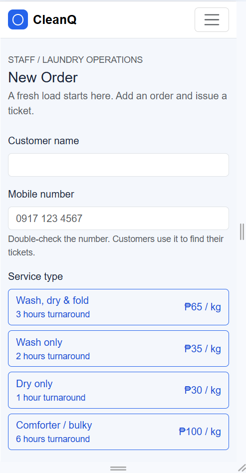
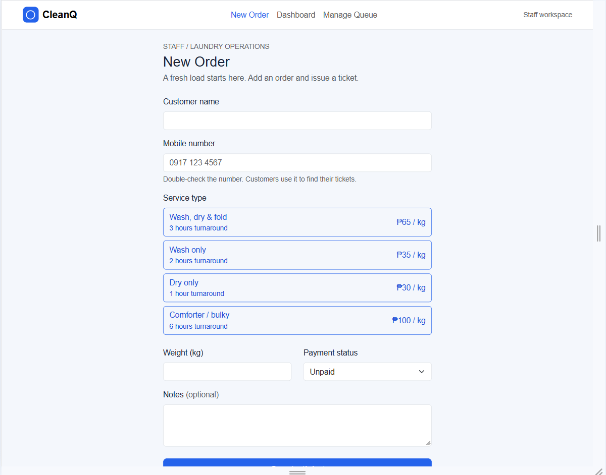
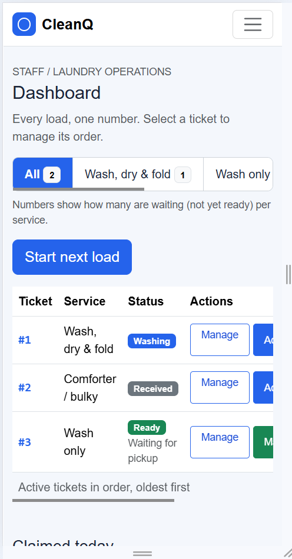
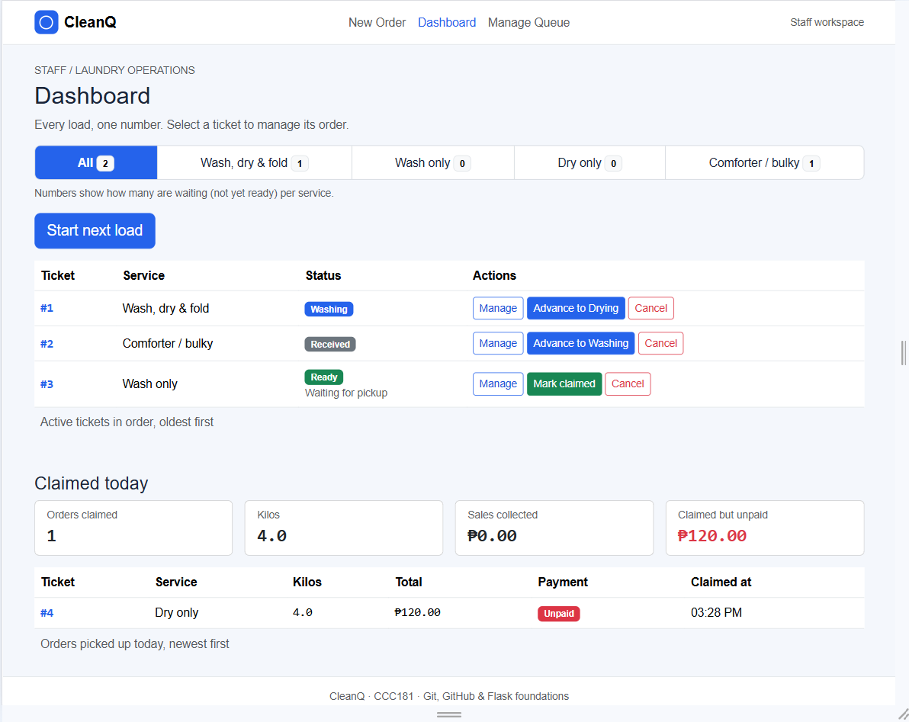
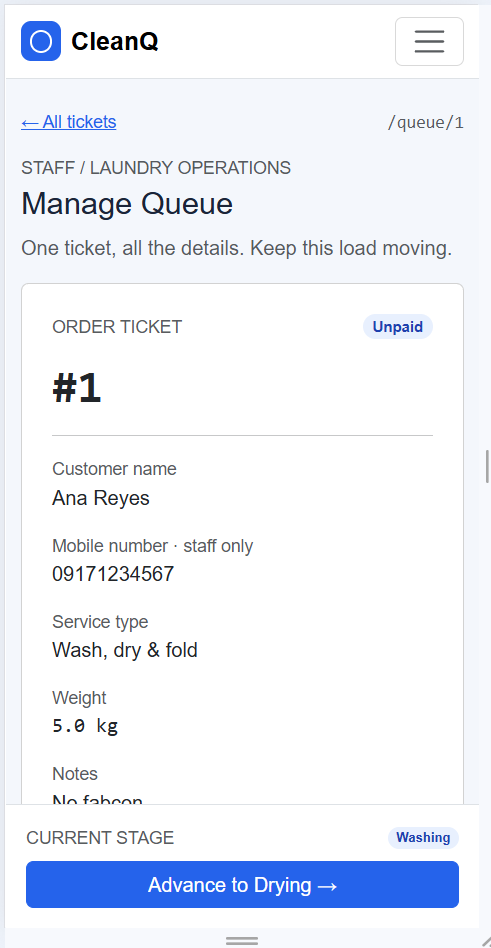
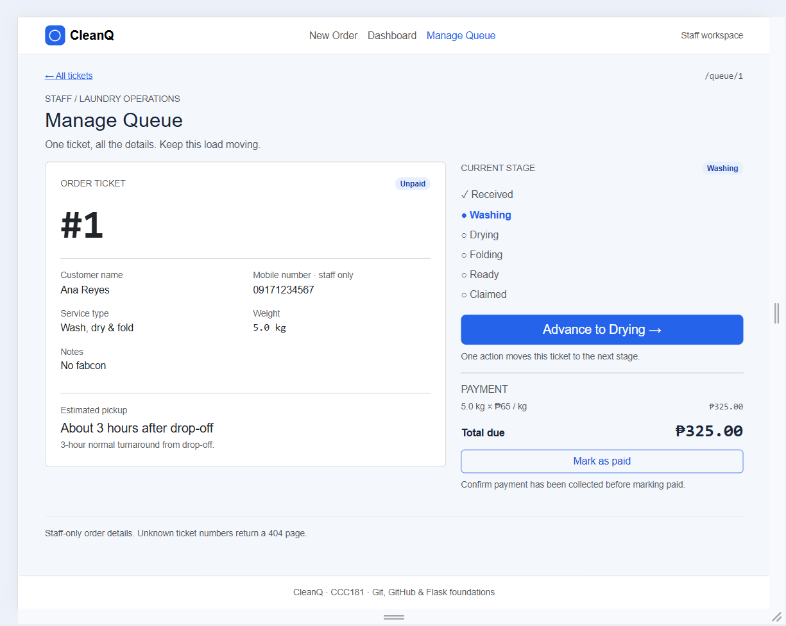

# CleanQ: Week 3 Report

## Title details

- **App:** CleanQ, a laundry order queue and pickup tracker
- **Setting:** Small neighborhood laundry shops in the Philippines
- **Name:** Kate Mikaela R. Dagohoy
- **Student ID:** 2024-0018
- **Course:** CCC181 
- **Date:** 10/25/2026

## Personas

Full details: [personas.md](personas.md)

**Kim Possible, 20, dorm student (customer).** Quote: "Is my laundry ready yet?" *(my own wording based on observation; I did not interview anyone, so this is not a real quote)*. Top tasks: look up tickets with her mobile number (FR-07), see status and estimated pickup (FR-06, FR-08).

**Mort, 48, owner who works the counter (staff).** Quote: "Ready na ba?" *(the question customers keep asking him, from my observation, not an interview quote)*. Top tasks: see all active tickets (FR-01), open a ticket (FR-02), log a new order (FR-09), advance stages (FR-10), mark paid (FR-11).

## Screens

| Screen | Phone | Laptop |
| --- | --- | --- |
| New Order |  |  |
| Dashboard (customer) |  |  |
| Manage Queue |  |  |

- **New Order:** Mort creates a ticket here, with service, weight, total and estimated pickup (FR-03, FR-04, FR-05, FR-06, FR-09).
- **Dashboard:** Kim enters her mobile number and sees her ticket, current stage, estimated pickup and tickets ahead (FR-06, FR-07, FR-08). Mort uses the staff version to see active tickets and the day's claimed orders (FR-01, FR-10, FR-11).
- **Manage Queue:** Mort opens one ticket to see its details, advance its stage and mark it paid (FR-02, FR-05, FR-06, FR-10, FR-11).

## Design decisions

1. **The customer view shows only her own tickets and a "N tickets ahead" count, never other tickets or mobile numbers.** My wireframe self-review found that the shop-wide ticket grid broke Kim's rule that she only sees tickets tied to her number (FR-08), so I moved that grid to the staff view.
2. **The customer lookup is the first thing on the Customer Dashboard, and the ticket number and stage are large and written in words.** Kim checks between classes with one hand free, so she must find her ticket with just her mobile number and read it at a glance. Status is words, not only color, which also came from the accessibility check.
3. **On phones, the Advance button is pinned to the bottom of Manage Queue.** My self-review found that Mort's most frequent action was below the fold on a phone, which breaks his rule about few taps with busy hands.

## Self-review

Main problems from [feedback.md](feedback.md) and what I changed:

- **New Order:** the customer lookup sat under a staff form, and the tab was called "Join Queue". I removed the lookup from this screen and renamed the tab "New Order".
- **Customer Dashboard:** the shop queue grid showed every other customer's ticket number and pushed the lookup to the bottom. I split the Dashboard into a customer view (own tickets plus a "tickets ahead" count, lookup at the top) and a staff view (full list of tickets).
- **Manage Queue:** on a phone, the Advance button was below the whole order card. I pinned a bottom bar with the current stage and the Advance button.

## Accessibility

Full details: [accessibility.md](accessibility.md)

| Screen | Accessibility score at first run | After fixes |
| --- | --- | --- |
| New Order (/join) | 95 | ___ |
| Customer Dashboard: lookup (/track) | 100 | 100 |
| Customer Dashboard: ticket (/track/1) | 100 | 100 |
| Staff Dashboard (/staff) | 100 | 100 |
| Manage Queue (/queue/1) | 96 | ___ |

Most important fix: low text contrast on the service buttons on New Order and on the "Mark as paid" button on Manage Queue. I set a darker blue for outline buttons in `style.css` and used that style for "Mark as paid". I also added a hidden `<h1>` to the ticket page, a 44 px minimum height for small buttons on phones, and made Manage Queue always reachable from the staff menu.

## Usability test

Full details: [usability-test.md](usability-test.md)

One person who fits my Kim persona (a student who does laundry, not in CCC181) tried three tasks without help from me, except where noted.

| Task | Finished? | Time | Notes |
| --- | --- | --- | --- |
| 1. Get in line for Wash only | Yes, with help | Less than a minute | Hesitated only to read what to do |
| 2. Find number and tickets ahead | Yes | At a glance after entering the number | No remarks |
| 3. As staff, start the next load and mark a ticket claimed | Yes | Less than a minute | Said the prices are too expensive (these are my own sample prices, so I did not change the interface) |

Persona rules that held: Kim's lookup with only a mobile number, plain text, and no mobile number on customer pages; Mort's large buttons, plain labels and a clearly shown stage. One rule held only partly: Mort's "only ticket numbers on the dashboard", since the dashboard table also shows service and status. The tester did not mind, but I did not follow the rule strictly.

**Improvement:** Manage Queue only appeared in the staff menu after a ticket was created or opened, so staff could not reach it from New Order or the Dashboard. It is now always in the menu (it opens the oldest active ticket), and each Dashboard row has a "Manage" button.

| Before | After |
| --- | --- |
|  |  |

## Reflection

*(Edit this so it is in your own words.)*

The hardest part this week was thinking of the different possible scenarios where a user could encounter problems. Privacy was also an issue regarding the usage of phone numbers to keep track for the part of the customer. I also found the template and styling to be a challenge to make sure that everything stayed simple and easy to read while trying not to make it look so plain. I also encountered errors when editing screens and pages and had a hard time.

In Week 4, tickets will be saved in a database instead of the `TICKETS` list, so they survive a restart. The claimed-today log will use stored claim times, "tickets ahead" will become a database query, and the lookup by mobile number will query the database instead of a list.

## Declaration

I used Claude (Anthropic) to help debug Flask routes, Jinja templates, CSS and JavaScript.