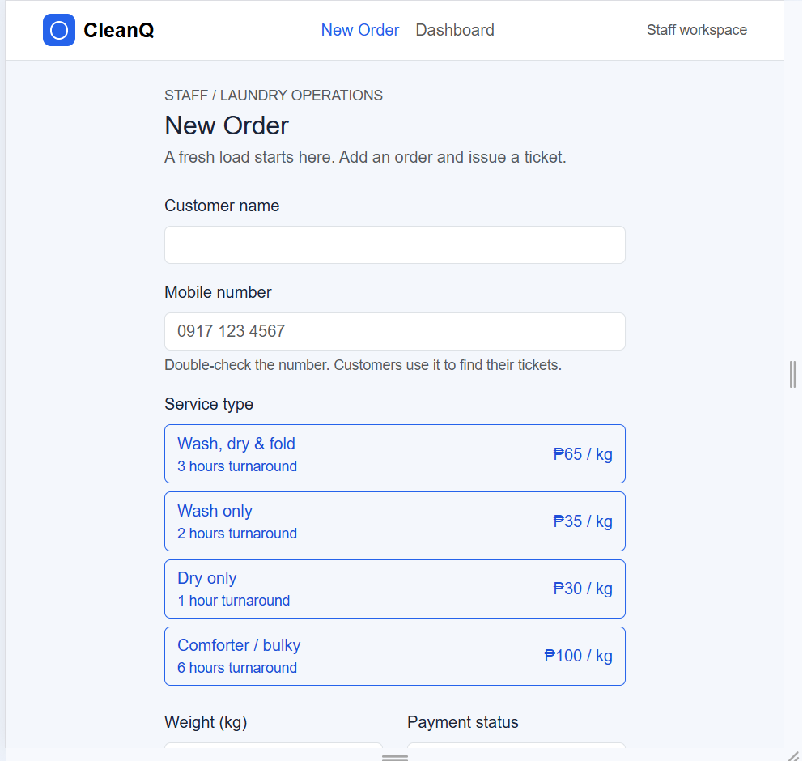
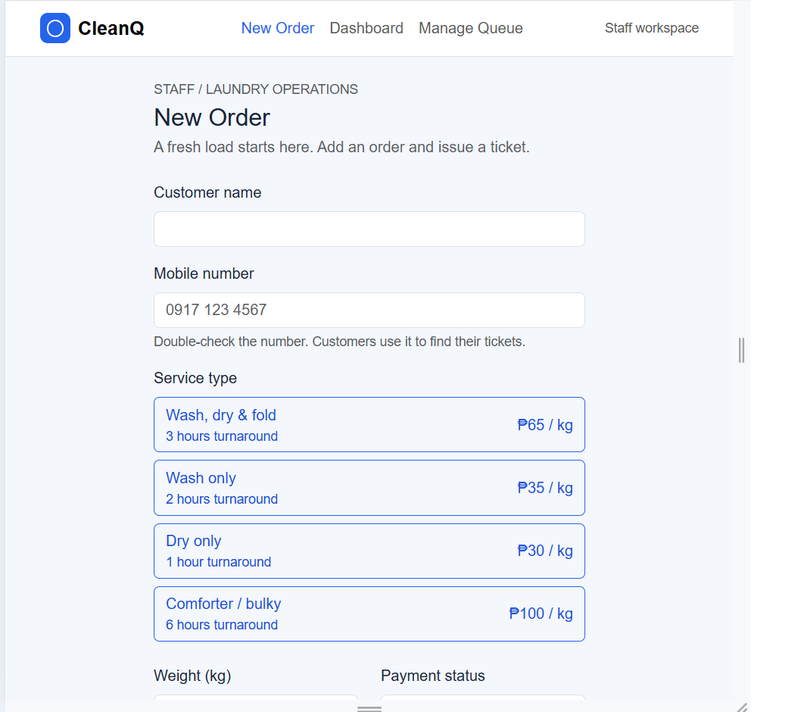

# CleanQ Usability Test

**Tester:** one person who fits my Kim Possible persona (a student who does laundry), not in CCC181. Name withheld.
**Date:** 10/25/2026
**Setup:** Laptop in person
**Permission:** The tester consented to be taken notes of.s

## Task results

| Task | Finished? (yes / with help / no) | Time | Remarks |
| --- | --- | --- | --- |
| 1. Get in line for Wash only | Yes, with help | Less than a minute | They hesitated only to read what to do. |
| 2. How many tickets are ahead? What is your number? | Yes | At a glance after entering number | No remarks |
| 3. As staff, start the next load and mark a ticket claimed | Yes | Less than a minute | They said the prices are too expensive. |

## Persona rules: which held up

**Kim**
- Find my ticket with just my mobile number, no sign-up: Held. Easy and simple.
- List ticket numbers first, details after a tap: It tells how many tickets are before me and when the estimated time is.
- Lightweight, plain text: Texts are plain and simple.
- Mobile number never shown on customer pages: Held.

**Mort**
- Large buttons, few taps: Buttons are in your face and are easy to navigate.
- Only ticket numbers on the dashboard: Partly held. The tester could see ticket numbers along with their status and found that fine, but the dashboard table also shows service, so the rule is not followed strictly.
- Plain English labels: Held.
- Current stage clearly shown on the ticket page: Held.

## 10b. The one improvement

**Problem (from my self-review and accessibility check):** The "Manage Queue" tab only appeared after a ticket was created or opened. Staff could not reach it from New Order or the Dashboard, and tickets on the Dashboard did not clearly lead to their detail page.

**Fix:** Manage Queue is now always in the staff menu (it opens the oldest active ticket, or returns to the Dashboard with a message if none are active). Each Dashboard row also has a "Manage" button.

**Before:** 

**After:** 