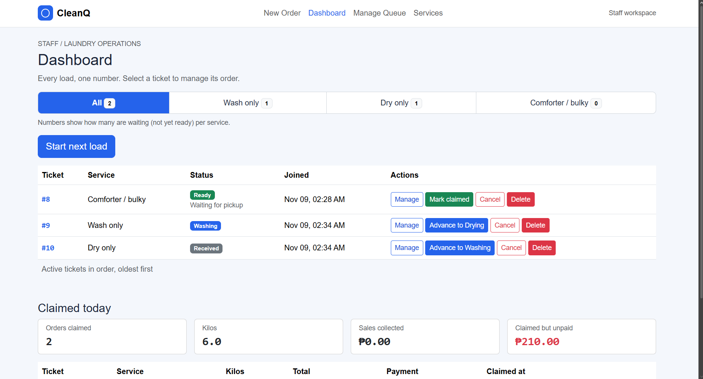
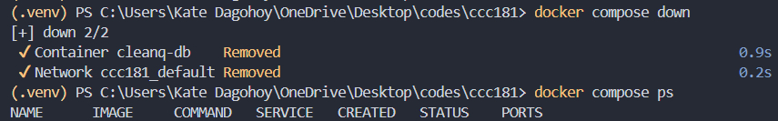
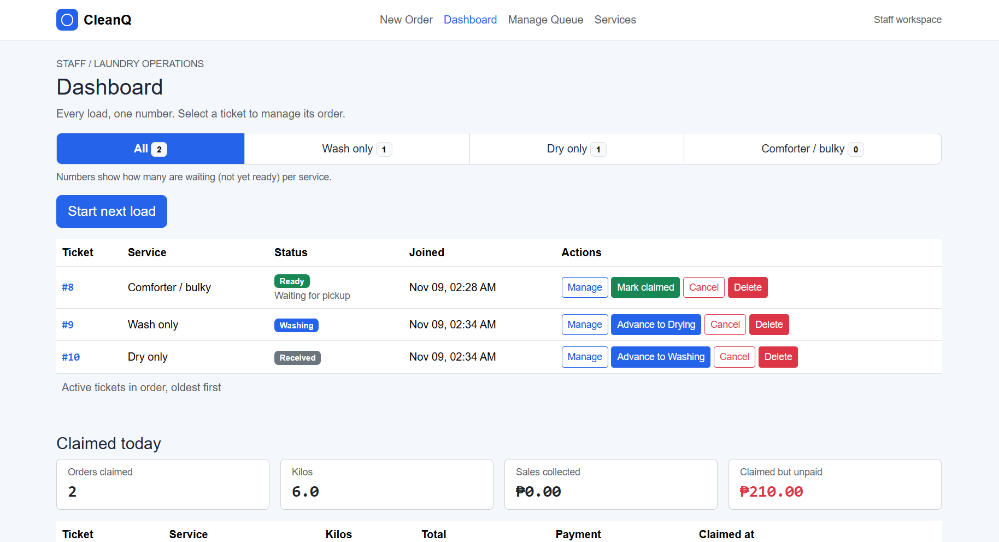
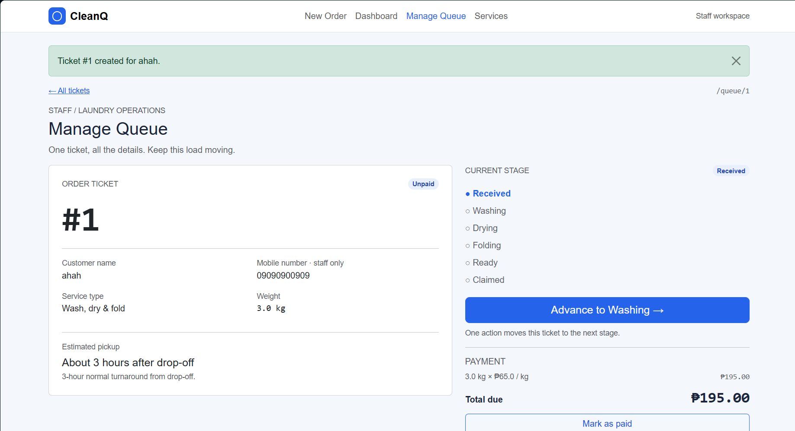

# CleanQ persistence test

## Restart test (NFR-01: no ticket is lost when the server or database restarts)

1. Created <number> tickets across <number> services. Started one load (Start next load), claimed one, and one customer left the queue.
2. Before the restart:

   
   

3. Stopped Flask with Ctrl+C, ran `docker compose down`, then `docker compose ps`. Nothing was running.

   

4. Ran `docker compose up -d`, waited until `docker compose ps` said healthy, then started Flask again.
5. After the restart:

   
   

**Result:** <every ticket, status and time was exactly the same / describe any difference>. NFR-01 <passed / failed>.

## Rebuild from scratch

Ran `docker compose down -v`, `docker compose up -d`, `flask --app app db upgrade` and `flask --app app seed`, which deleted all data and rebuilt it from the migrations.

**Result:** <the app opened, the join form showed all four services, and I could create a ticket>. The migrations <rebuilt the whole database without errors / describe any problem and the new migration that fixed it>.