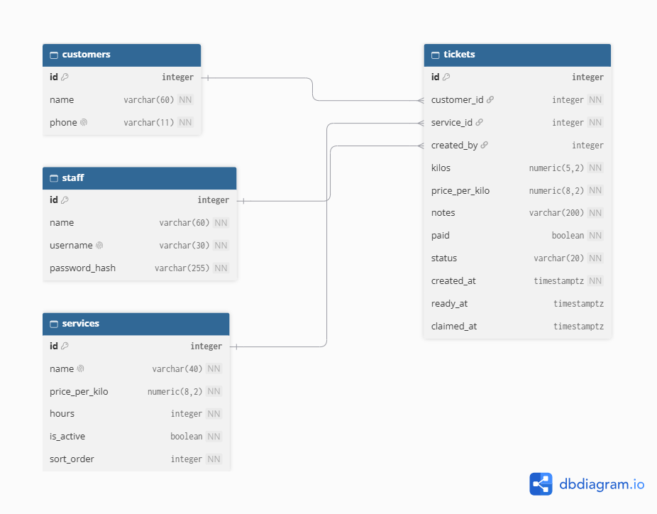
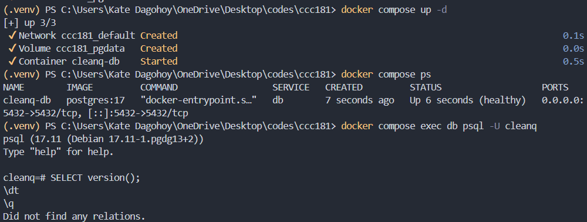
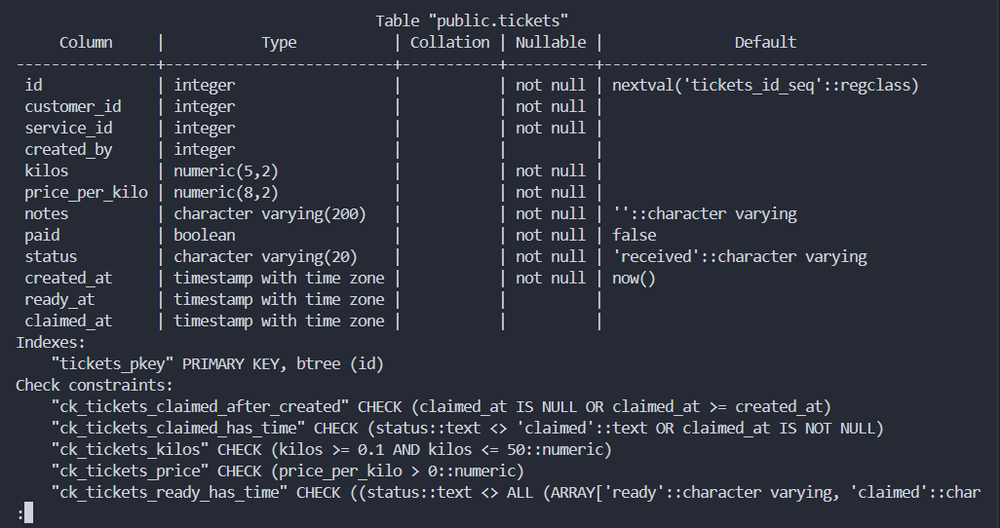
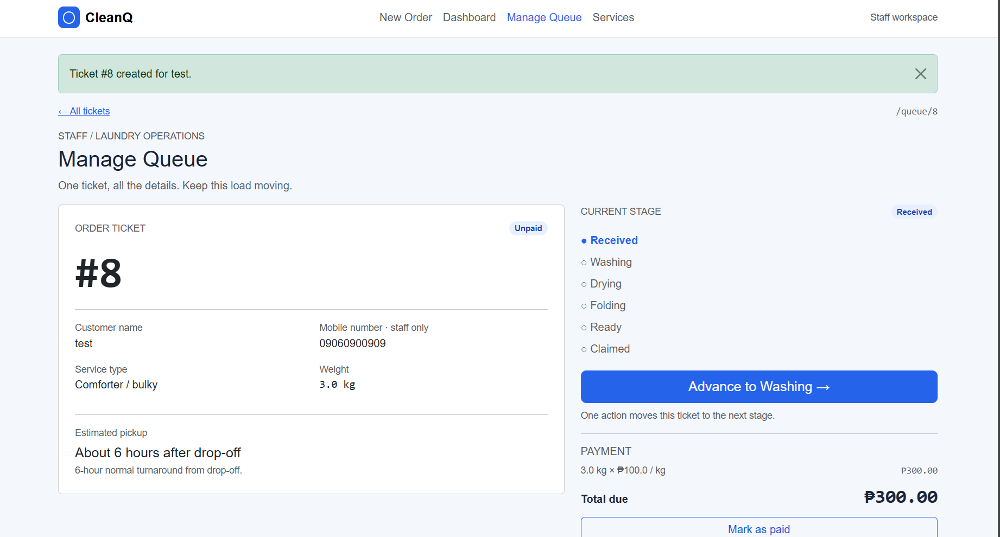
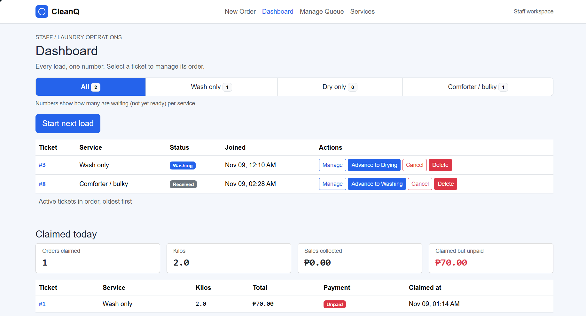
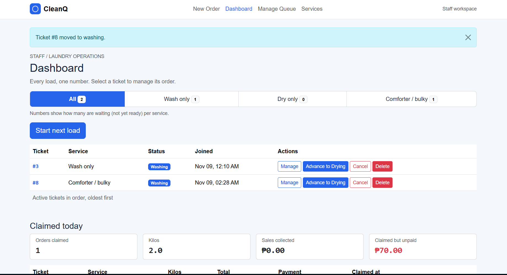
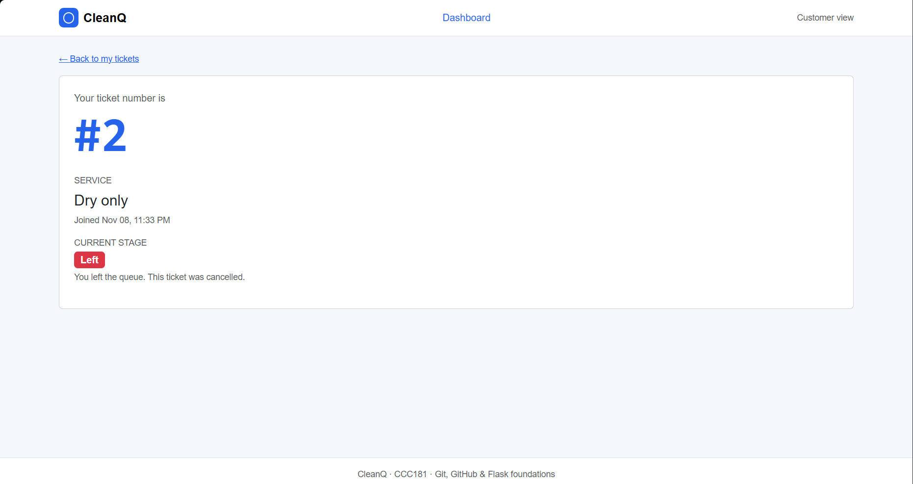
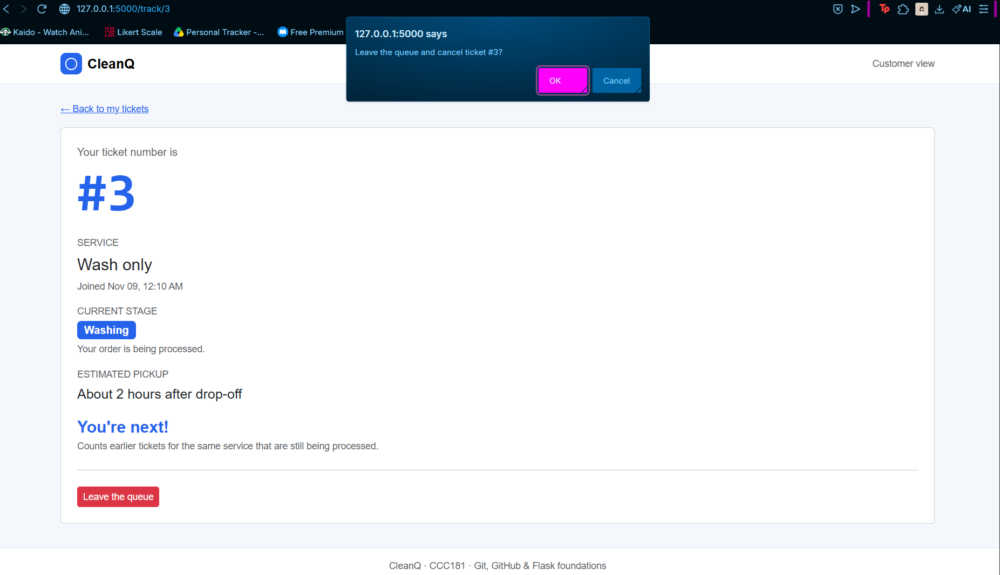
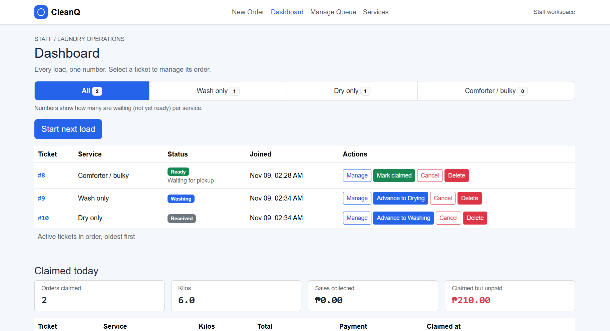

# CleanQ: Week 4 Report

## Title details

- **App:** CleanQ, a laundry order queue and pickup tracker
- **Setting:** Small neighborhood laundry shops in the Philippines
- **Name:** Kate Mikaela R. Dagohoy
- **Student ID:** 2024-0018
- **Course:** CCC181
- **Date:** 11/9/2026
- **Database:** PostgreSQL 17 in Docker Compose

## Requirements

I wrote 19 functional and 7 non-functional requirements, with 5 marked ★ for the laundry setting. Full list: [docs/requirements.md](../requirements.md).

**MVP:** FR-01 to FR-09, FR-12, and NFR-01, NFR-02, NFR-04, NFR-05, NFR-06. These cover the whole loop: staff log and advance orders, customers check their own ticket, and everything survives a restart.

**Check with a real person:** A laundry customer said they could not think of anything missing, because it covers the basics and more features would only make it complicated. Their most important requirements were FR-01, FR-03 and FR-08. I changed nothing, and kept SMS, online payment and delivery out of scope.

## ERD

- One customer has many tickets. Each ticket belongs to exactly one customer. (1:N)
- One service has many tickets. Each ticket belongs to exactly one service. (1:N)
- One staff member creates many tickets. Each ticket was created by at most one staff member. (1:N)

Full schema design: [docs/week4/schema.md](schema.md)

## Schema

`\d customers`, `\d staff` and `\d services`:

`\d tickets`:

## Design decisions

1. **Customers are in their own table, not on every ticket.** Kim finds her tickets with only her mobile number (FR-07), so the number must be unique and stored once. Before this, Ana Reyes was stored twice. Now a name or number change is made in one row.
2. **Each ticket keeps its own `price_per_kilo`.** Staff can change a service's price (FR-12), and old tickets and "Claimed today" sales must not change when they do. The total is still computed from kilos × price, not stored.
3. **"Tickets ahead" is counted, never stored.** Kim needs to see how many are ahead of her (FR-08). A stored position would have to be rewritten for many rows every time someone joins, leaves or is claimed, so it is a count query on the status and `created_at`.

## Self-review

Full details: [docs/week4/schema-review.md](schema-review.md). The main problems I found and what I changed:

- **Status and time columns could disagree.** A ticket could be claimed with no claim time, so it would be missing from "Claimed today". I added table-level CHECK constraints on `tickets` so the database rejects it.
- **Unneeded columns.** `created_at` on `customers` and `staff` was not needed by any requirement, so I removed it from the models and the ERD.
- **Mistakes the database cannot catch.** A ticket for a switched-off service and a double tap on "Create ticket" are not blocked by any constraint. I handled them in Flask (only active services are accepted) and with the double-submit guard in `main.js`.
- **Estimated pickup.** It follows the service's current turnaround, so I kept it computed and did not store a copy that could go out of date.

## Migrations

| File | What it does |
|---|---|
| `migrations/versions/dbaed13c4eba_initial_tables.py` | Creates the four tables (customers, staff, services, tickets) with all keys and constraints. |
| `migrations/versions/4790d08730d0_add_services_sort_order.py` | Adds `services.sort_order`, so staff can choose the order of services on New Order. |

## CRUD

| | Route | Requirement | Screenshot |
|---|---|---|---|
| Create | `POST /join` | FR-01 |  |
| Read | `GET /staff`, `GET /track/<id>` | FR-02, FR-08 |  |
| Update | `POST /staff/tickets/<id>/advance` | FR-04 |  |
| Soft delete | `POST /track/<id>/leave` | FR-09 |  |
| Hard delete | `POST /staff/tickets/<id>/delete` | FR-19 |  |

Services also have full CRUD at `/staff/services` (FR-12). Deleting a service that has tickets is refused.

## Validation

Full details: [docs/week4/validation.md](validation.md). I tested every rule in the layer it belongs to: the browser helps honest users, Flask rejects bad requests with 400 and saves nothing, and PostgreSQL rejects bad data with the constraints for foreign key, check, unique, not null and restrict.

I also found a real bug while testing: `kilos=NaN` would have crashed the join route with a 500 error, because Python cannot compare NaN. I fixed it so it now returns 400.

It was useful because it names the exact constraint that blocked the row, so I could tell which rule I had written and which ticket data broke it without guessing.

## Persistence

Full details: [docs/week4/persistence.md](persistence.md)

| Before restart | After restart |
|---|---|
|  |  |

After `docker compose down` and `docker compose up -d`, every ticket, status and time was identical to before. I also ran `docker compose down -v`, `docker compose up -d`, `flask --app app db upgrade` and `flask --app app seed`, which deleted all the data and rebuilt it from the migrations. The app opened, the join form showed all four services, and I could create a ticket. NFR-01 (no ticket is lost on restart) passed.

## Reflection

- **Hardest part this week:** Moving the whole app from the in-memory `TICKETS` list to the database. Every route and template had to change, and one small mistake, like a line pasted in the wrong place in `models.py`, stopped the whole app from starting. I also did not expect that an unticked box on the Manage services page does nothing until I press Save, which made one of my tests look broken when it was not.
- **Requirement hardest to write in a testable way:** NFR-07, "a staff member can create an order in under 30 seconds on a phone". Unlike a constraint in the database, it depends on a real person and a stopwatch, so I could not check it by only running my code. I would need a real shop attendant to time it.
- **A report my staff persona would want:** Mort would want a daily report of how many claimed orders were still unpaid, with the kilos and sales per service per day, so he knows how much money is waiting to be collected. I will write that query in Week 5.

## Declaration

I used Claude (Anthropic) to help draft schema and help with debugging errors.