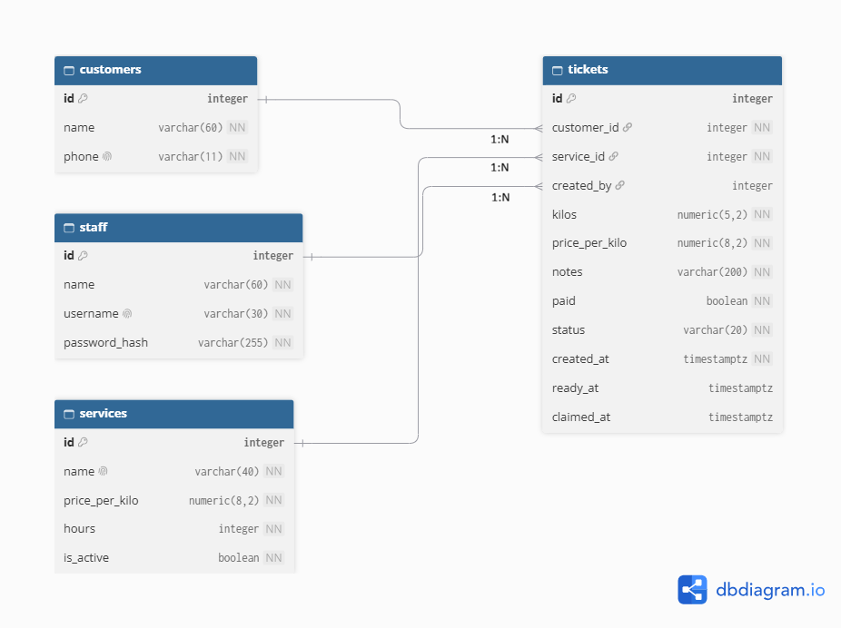

# CleanQ schema

Requirements are in [docs/requirements.md](../requirements.md).

## 2a. Nouns in the requirements

Only requirements with Stores data? = Yes are listed (FR-14 is No).

| Req ID | Requirement | Nouns | Table or column? |
|--------|-------------|-------|------------------|
| FR-01 | A **staff member** can create an **order** by entering the customer's **name**, **mobile number**, **service**, **kilos**, **paid or unpaid** and **notes**, and get the next **ticket number**. | staff member, order, name, mobile number, service, kilos, paid, notes, ticket number | staff, tickets, customers.name, customers.phone, services, tickets.kilos, tickets.paid, tickets.notes, tickets.id |
| FR-02 | A staff member can see all active **tickets** in **ticket order** and filter them by **service**. | ticket, ticket order, service | tickets, services, (order is computed from tickets.id) |
| FR-03 | A staff member can open a ticket to see its **name, mobile number, service, kilos, notes, total price, payment status, stage and estimated pickup**. | total price, payment status, stage, estimated pickup | tickets.price_per_kilo, tickets.paid, tickets.status, (total is computed), (estimated pickup is computed) |
| FR-04 | A staff member can move a ticket to its next **stage**. | stage | tickets.status, tickets.ready_at, tickets.claimed_at |
| FR-05 | A staff member can mark a ticket as **paid**. | paid | tickets.paid |
| FR-06 | A staff member is warned when a ticket is **claimed** while still **unpaid**. | claimed, unpaid | (computed from tickets.status and tickets.paid) |
| FR-07 | A **customer** can enter only their **mobile number** to see their own **tickets**. | customer, mobile number, ticket | customers, customers.phone, tickets.customer_id |
| FR-08 | A customer can see their **ticket number, service, stage, estimated pickup** and **tickets ahead**. | ticket number, service, stage, estimated pickup, tickets ahead | tickets.id, tickets.service_id, tickets.status, (estimated pickup is computed), (tickets ahead is computed) |
| FR-09 | A customer can **leave the queue** before their laundry is finished. | queue, leave | (queue is not a table), tickets.status = 'left' |
| FR-10 | A staff member can start the **next waiting load**. | next waiting load | (computed: oldest ticket with status 'received') |
| FR-11 | A staff member can see **today's claimed orders** with **kilos, sales** and **unpaid totals**. | claimed orders, sales, unpaid total | tickets.claimed_at, (totals are computed) |
| FR-12 | A staff member can add, rename, change the **price or turnaround** of, and **switch off** a **service**. | service, name, price, turnaround, switched off | services, services.name, services.price_per_kilo, services.hours, services.is_active |
| FR-13 | A staff member can **cancel** a ticket. | cancel | tickets.status = 'left' |
| FR-15 | A staff member can see **ready but unclaimed** orders after a set number of days. | ready time, unclaimed | tickets.ready_at, (unclaimed days are computed) |
| FR-16 | A staff member can see all **unpaid** orders. | unpaid | tickets.paid |
| FR-17 | A staff member must **log in**. | staff member, username, password | staff, staff.username, staff.password_hash |
| FR-18 | A staff member can correct the **kilos or notes** of an order. | kilos, notes | tickets.kilos, tickets.notes |

Two rules I followed:
- **The queue is not a table.** It is all tickets with status `received`, `washing`, `drying` or `folding` for one service, ordered by `created_at`.
- **Store facts, not results.** I store `created_at`, `ready_at` and `claimed_at` and compute tickets ahead, estimated pickup and total price when needed. One exception is on purpose: `tickets.price_per_kilo` is a fact about the price at the time of the order, so changing a service's price (FR-12) does not change the total of old tickets or past sales.

## 2b. Tables

| Table | Columns |
|-------|---------|
| `customers` | id, name, phone |
| `staff` | id, name, username, password_hash |
| `services` | id, name, price_per_kilo, hours, is_active |
| `tickets` | id, customer_id, service_id, created_by, kilos, price_per_kilo, notes, paid, status, created_at, ready_at, claimed_at |

Where each fact belongs:
- Name and mobile number are about the person, so they go in `customers`. Before this, the app stored them again on every ticket (Ana Reyes appears twice).
- Price per kilo and turnaround are about the service, so they go in `services`.
- Kilos, notes, paid and status are about this one visit, so they go in `tickets`.
- Who created the ticket is about this one visit, so it goes in `tickets.created_by`.

## 2c. Types and constraints

| Table | Column | PostgreSQL type | Constraint | Why |
|-------|--------|-----------------|------------|-----|
| customers | id | integer, generated | PRIMARY KEY | Generated by the database, never reused |
| customers | name | varchar(60) | NOT NULL | Every customer has a name, max 60 as in the form |
| customers | phone | varchar(11) | NOT NULL UNIQUE, CHECK (phone ~ '^09[0-9]{9}$') | One customer per mobile number; only valid PH mobile numbers; stored as text because it is an identifier, not a number to calculate with |
| staff | id | integer, generated | PRIMARY KEY | Generated by the database |
| staff | name | varchar(60) | NOT NULL | Shown in the app |
| staff | username | varchar(30) | NOT NULL UNIQUE | One account per username |
| staff | password_hash | varchar(255) | NOT NULL | Only a hash is stored, never the password |
| services | id | integer, generated | PRIMARY KEY | Generated by the database |
| services | name | varchar(40) | NOT NULL UNIQUE | No two services with the same name |
| services | price_per_kilo | numeric(8,2) | NOT NULL, CHECK (price_per_kilo > 0) | Exact money value; rejects zero or negative prices |
| services | hours | integer | NOT NULL, CHECK (hours > 0) | Turnaround must be a positive number of hours |
| services | is_active | boolean | NOT NULL DEFAULT true | Switch a service off without deleting it |
| tickets | id | integer, generated | PRIMARY KEY | The ticket number; generated by the database, so two orders can never get the same one |
| tickets | customer_id | integer | NOT NULL REFERENCES customers(id) | No ticket for a missing customer |
| tickets | service_id | integer | NOT NULL REFERENCES services(id) | No ticket for a missing service |
| tickets | created_by | integer | REFERENCES staff(id) (nullable) | Who logged the order; empty until staff login is built |
| tickets | kilos | numeric(5,2) | NOT NULL, CHECK (kilos >= 0.1 AND kilos <= 50) | Same limits as the New Order form |
| tickets | price_per_kilo | numeric(8,2) | NOT NULL, CHECK (price_per_kilo > 0) | Price at the time of the order, so old totals stay correct |
| tickets | notes | varchar(200) | NOT NULL DEFAULT '' | Same 200-character limit as the form |
| tickets | paid | boolean | NOT NULL DEFAULT false | Paid or unpaid only |
| tickets | status | varchar(20) | NOT NULL, CHECK (status IN ('received','washing','drying','folding','ready','claimed','left')) | Only the allowed stages |
| tickets | created_at | timestamptz | NOT NULL DEFAULT now() | When the order was made; used for order in the queue and estimated pickup |
| tickets | ready_at | timestamptz | (nullable) | Set when the stage becomes ready; used for unclaimed orders |
| tickets | claimed_at | timestamptz | (nullable) | Set when claimed; used for "Claimed today" |

**Table-level CHECK constraints on `tickets`:**

| Constraint | Why |
|------------|-----|
| CHECK (status <> 'claimed' OR claimed_at IS NOT NULL) | A claimed ticket must have a claim time, or it would be missing from "Claimed today" |
| CHECK (status NOT IN ('ready', 'claimed') OR ready_at IS NOT NULL) | A ready or claimed ticket must have a ready time, so the unclaimed list works |
| CHECK (claimed_at IS NULL OR claimed_at >= created_at) | A ticket cannot be claimed before it was created |

Used at least once: PRIMARY KEY, FOREIGN KEY (REFERENCES), NOT NULL, UNIQUE, CHECK and timestamptz.

## 2d. ERD

**Relationships:**
- One customer has many tickets. Each ticket belongs to exactly one customer. (1:N)
- One service has many tickets. Each ticket belongs to exactly one service. (1:N)
- One staff member creates many tickets. Each ticket was created by at most one staff member. (1:N)

The foreign key is always on the "many" side, `tickets`.

**What happens when the parent row is deleted:**

| Foreign key | Rule | Reason |
|-------------|------|--------|
| tickets.customer_id → customers.id | RESTRICT | A customer with tickets cannot be deleted. The shop needs old tickets for sales and unpaid records. |
| tickets.service_id → services.id | RESTRICT | A service with tickets cannot be deleted. Staff switch it off with `is_active` instead (FR-12). |
| tickets.created_by → staff.id | SET NULL | If a staff account is removed, the tickets stay. Only "who created it" becomes empty. |

## 2e. Normalization

1. **One value per cell (1NF):** Yes, every column holds one value. Notes is free text and is not read as a list. Each ticket has exactly one service, so no column holds a list of services.
2. **Depends on the whole key (2NF):** There are no join tables, because there are no many-to-many relationships. Every column in each table depends on that table's single `id`.
3. **No hidden copies (3NF):** Customer name and mobile number are stored once in `customers`, not on every ticket, so a change is made in one row. Service name and turnaround are stored once in `services`. The only repeated value is `tickets.price_per_kilo`, which is a snapshot of the price when the order was made. It is not a copy that must stay in sync, so changing a service's price on purpose must not change it.